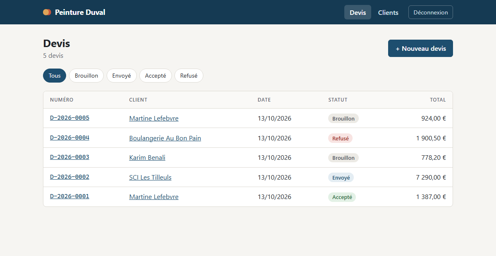
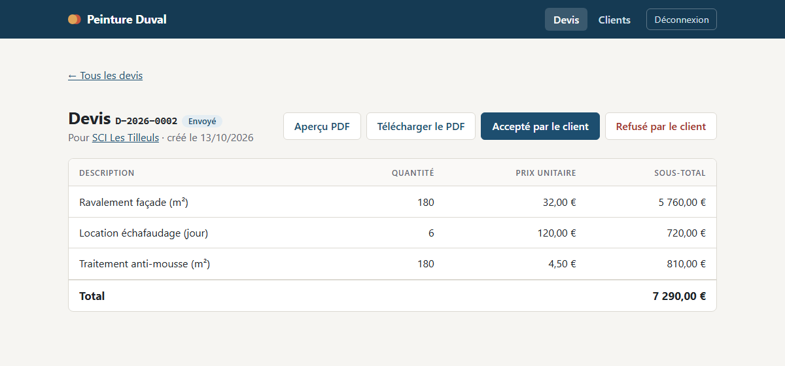
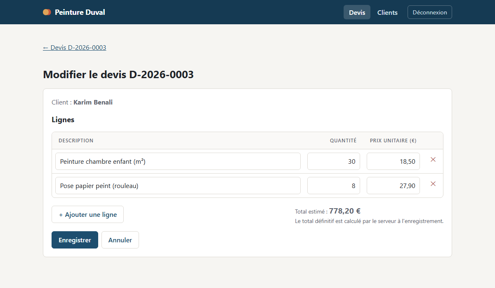
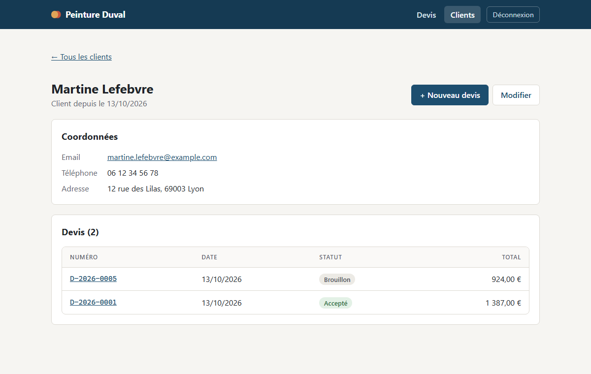
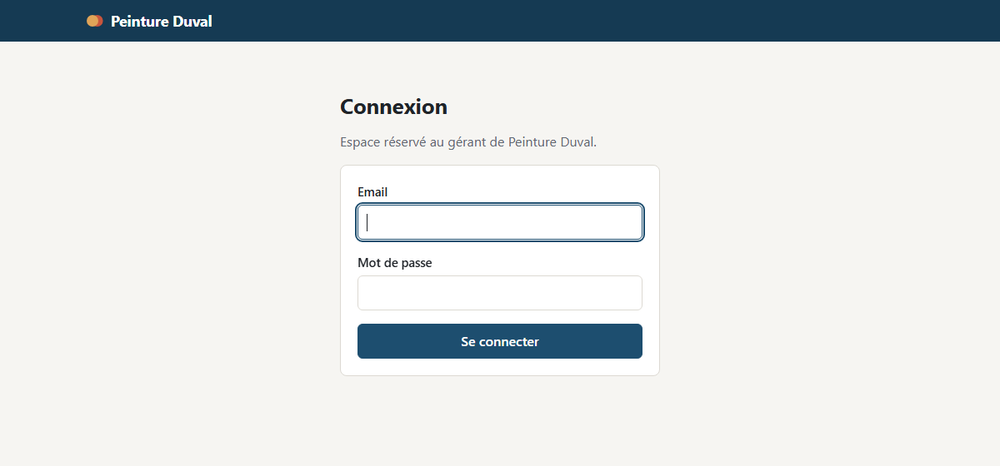

# Devis Duval

Application web de gestion de devis pour **SARL Peinture Duval** (client
fictif), réalisée dans le cadre du Portfolio Holberton.

Le gérant crée des clients, puis des devis composés de lignes
(description, quantité, prix unitaire). **Le total d'un devis est toujours
calculé côté serveur**, jamais saisi à la main. Chaque devis se télécharge
en PDF, prêt à être envoyé au client.

**Démo en ligne** : https://devis-duval.onrender.com (identifiants du gérant
de démo sur demande ; l'**Espace client** du menu affiche un compte client de
démo). Offre gratuite de Render : le premier chargement après
une période d'inactivité peut prendre une minute, et les données de démo
sont remises à zéro à chaque redémarrage (voir
[Mise en ligne](#mise-en-ligne-render)).



## Fonctionnalités

- **Clients** : liste, fiche avec l'historique des devis, création,
  modification, suppression (refusée si le client a des devis). Un client
  doit avoir **au moins un email ou un téléphone**.
- **Devis** : création avec ajout de lignes et total estimé en direct,
  numéro automatique (`D-2026-0001`), filtre par statut.
- **Cycle de vie** : brouillon → envoyé → accepté ou refusé. Un devis
  envoyé n'est plus modifiable ni supprimable.
- **Envoi par email** : quand un devis passe à « envoyé », le client le
  reçoit par email (PDF joint) avec un lien pour créer son espace client.
- **Espace client** : le client crée son compte avec son email, puis
  consulte ses devis (sauf les brouillons), les télécharge en PDF et
  **les accepte ou les refuse en ligne** ; le gérant est prévenu par email.
- **PDF** : en-tête de l'entreprise, client, lignes, total, date de
  validité, cadre « Bon pour accord » ([exemple](docs/exemple-devis.pdf)).
- **Connexion** du gérant et des clients : chacun ne voit que ses pages,
  mots de passe hachés.
- **API REST JSON** documentée avec Swagger (`/apidocs/`).
- **Qualité** : plus de 200 tests pytest, style pycodestyle, CI GitHub
  Actions (tests + build Docker).

| Détail d'un devis | Création / modification |
|---|---|
|  |  |
| **Fiche client** | **Connexion** |
|  |  |

## Stack

- Python 3.12 / Flask 3 (factory `create_app()`), templates Jinja
- SQLAlchemy (Flask-SQLAlchemy) + Flask-Migrate, SQLite
- Flask-Login (connexion), Flask-WTF (CSRF), xhtml2pdf (PDF), Flasgger (Swagger)
- pytest, pycodestyle, GitHub Actions
- Docker / docker-compose, gunicorn, déploiement Render

## Structure

```
app/
  __init__.py        factory create_app()
  config.py          Config (lit .env) / TestConfig (SQLite mémoire)
  extensions.py      SQLAlchemy (+ PRAGMA foreign_keys), Migrate, CSRFProtect, LoginManager
  models/            Client, Devis, LigneDevis, Utilisateur
  auth.py            connexion (Flask-Login), création du compte client, droits
                     d'accès + commande flask creer-gerant
  espace.py          espace client : ses devis, détail, PDF
  invitations.py     lien signé de création du compte client
  notifications.py   emails aux clients (devis envoyé, invitation)
  emails.py          envoi SMTP, ou affichage dans le terminal sans serveur
  errors.py          erreurs HTTP : JSON sous /api/, page HTML ailleurs
  routes/health.py   GET /api/health
  routes/clients.py  CRUD /api/clients
  routes/devis.py    /api/devis : lignes, totaux, statuts
  pages/             interface web (clients, devis) qui réutilise les règles de routes/
  pdf.py             génération du devis en PDF (xhtml2pdf)
  templates/         templates Jinja (base, clients/, devis/, espace/, emails/, erreur)
  static/style.css   styles de l'interface
  seed.py            commande flask seed (données de démo)
  swagger.py         config Flasgger + schémas OpenAPI partagés
tests/               modèles, API, pages, PDF, connexion, config, Swagger
migrations/          migrations Alembic
docs/                captures d'écran et exemple de devis PDF
run.py               point d'entrée
Dockerfile, docker-compose.yml, docker-entrypoint.sh
render.yaml          déploiement sur Render
```

## Modèle de données

| Table          | Colonnes                                                                  |
|----------------|---------------------------------------------------------------------------|
| `clients`      | id, nom (obligatoire), email, telephone, adresse, cree_le                 |
| `devis`        | id, client_id → clients, numero (unique), date_creation, statut, total, reponse_en_ligne_le |
| `lignes_devis` | id, devis_id → devis (ON DELETE CASCADE), description, quantite, prix_unitaire, sous_total |
| `utilisateurs` | id, email (unique), mot_de_passe_hash, cree_le, client_id → clients (unique, ON DELETE CASCADE) |

- `devis.reponse_en_ligne_le` : date à laquelle le client a accepté ou
  refusé le devis depuis son espace (vide si le gérant a saisi la réponse).
- `utilisateurs.client_id` vide : compte du gérant ; rempli : compte de
  l'espace client de ce client (un seul compte par client).
- Montants en `DECIMAL(10,2)` et `decimal.Decimal` en Python, jamais en float.
- `CHECK (quantite > 0)` et `CHECK (prix_unitaire >= 0)`.
- `statut` ∈ brouillon / envoye / accepte / refuse (défaut : brouillon).
- `LigneDevis.calculer_sous_total()` et `Devis.calculer_total()` arrondissent
  au centime (`ROUND_HALF_UP`).

## API

Toutes les réponses sont en JSON. En cas d'erreur, le corps est
`{"erreur": "message"}`.

### Clients

| Méthode  | Route               | Effet                                   | Succès |
|----------|---------------------|-----------------------------------------|--------|
| `GET`    | `/api/clients`      | Liste les clients (ordre alphabétique)  | 200    |
| `POST`   | `/api/clients`      | Crée un client                          | 201    |
| `GET`    | `/api/clients/<id>` | Affiche un client                       | 200    |
| `PUT`    | `/api/clients/<id>` | Remplace un client (champ absent = vidé)| 200    |
| `DELETE` | `/api/clients/<id>` | Supprime un client                      | 204    |

Corps attendu pour `POST` et `PUT` :

```json
{
  "nom": "Mme Martin",
  "email": "martin@example.com",
  "telephone": "06 12 34 56 78",
  "adresse": "12 rue des Lilas, 69003 Lyon"
}
```

- `nom` est obligatoire (120 caractères max), ainsi qu'**au moins un** des
  champs `email` (120) et `telephone` (30) ; `adresse` (255) est
  facultatif. Les espaces autour sont retirés.
- `id`, `cree_le` et les champs inconnus sont ignorés.
- Erreurs : **400** (JSON absent ou champ invalide), **404** (client
  introuvable), **409** (suppression d'un client qui a des devis).

Exemple :

```bash
curl -X POST http://localhost:5000/api/clients \
     -H "Content-Type: application/json" \
     -d '{"nom": "Mme Martin", "email": "martin@example.com"}'
```

### Devis

| Méthode  | Route                    | Effet                                     | Succès |
|----------|--------------------------|-------------------------------------------|--------|
| `GET`    | `/api/devis`             | Liste les devis (`?client_id=`, `?statut=`) | 200  |
| `POST`   | `/api/devis`             | Crée un devis en brouillon                | 201    |
| `GET`    | `/api/devis/<id>`        | Affiche un devis et ses lignes            | 200    |
| `PUT`    | `/api/devis/<id>`        | Remplace les lignes (brouillon seulement) | 200    |
| `PATCH`  | `/api/devis/<id>/statut` | Fait avancer le statut                    | 200    |
| `DELETE` | `/api/devis/<id>`        | Supprime le devis (brouillon seulement)   | 204    |

Corps attendu pour `POST` (pour `PUT`, seulement `lignes`) :

```json
{
  "client_id": 1,
  "lignes": [
    {"description": "Peinture salon (m²)", "quantite": "32.5", "prix_unitaire": "24.90"},
    {"description": "Sous-couche", "quantite": 3, "prix_unitaire": "45.33"}
  ]
}
```

Règles :

- **Le serveur calcule** `sous_total` et `total`. Le numéro est **généré
  automatiquement** (`D-2026-0001`, `D-2026-0002`… par année) et le statut
  de départ est `brouillon`. Les valeurs `total`, `sous_total`, `numero` et
  `statut` envoyées par le client sont ignorées.
- Montants : nombre ou chaîne (`"24.90"` recommandé), 2 décimales au
  maximum. Quantité > 0, prix unitaire >= 0.
- Statut, sans retour en arrière (corps : `{"statut": "envoye"}`) :

  ```
  brouillon ──> envoye ──> accepte
                     └───> refuse
  ```

- Un devis sans ligne ne peut pas être envoyé.
- Un devis ne peut être ni créé ni envoyé pour un client sans email ni
  téléphone (clients enregistrés avant cette règle).
- Passage à `envoye` : si le client a un email, le devis lui est envoyé
  par email (voir [Espace client](#espace-client-et-emails)).
- Un devis qui n'est plus en brouillon ne peut plus être modifié ni
  supprimé.
- Erreurs : **400** (données invalides, client inexistant), **404** (devis
  introuvable), **409** (action interdite pour ce statut).

## Installation locale

```bash
python3 -m venv venv
source venv/bin/activate
pip install -r requirements.txt
cp .env.example .env       # puis remplir SECRET_KEY
flask db upgrade         # crée / met à jour la base SQLite
flask seed               # insère des données de démo (clients, devis)
flask creer-gerant gerant@duval.fr   # crée le compte (mot de passe demandé)
python run.py            # http://localhost:5000/
```

`flask` lit `FLASK_APP=run.py` dans `.env`, pas besoin de l'exporter.

Sous **Windows (PowerShell)**, pas besoin d'activer le venv (`Activate.ps1`
est souvent bloqué par la politique d'exécution) : on appelle directement
le Python du venv.

```powershell
py -m venv venv
.\venv\Scripts\python.exe -m pip install -r requirements.txt
Copy-Item .env.example .env   # puis remplir SECRET_KEY
.\venv\Scripts\flask.exe db upgrade
.\venv\Scripts\flask.exe seed
.\venv\Scripts\flask.exe creer-gerant gerant@duval.fr
.\venv\Scripts\python.exe run.py   # http://localhost:5000/
```

`ModuleNotFoundError: No module named 'flask'` : le serveur a été lancé avec
le Python global au lieu de celui du venv. Port 5000 déjà utilisé : un autre
serveur tourne déjà (le fermer, ou lancer avec `$env:PORT = "5001"`).

## Travailler dans VS Code

Le dossier `.vscode/` configure le projet : le Python du venv est choisi
automatiquement (chaque nouveau terminal active le venv), les tests
apparaissent dans le panneau **Tests**, et les commandes courantes sont des
tâches.

1. Ouvrir le projet **depuis Ubuntu (WSL)** : `cd` dans le dossier du projet,
   puis `code .`. En bas à gauche, VS Code affiche « WSL: Ubuntu ». Accepter
   les extensions recommandées (Python, Python Debugger, WSL).
2. Première fois : menu **Terminal → Exécuter la tâche…** →
   « Installer le projet (première fois) », puis
   « Créer ou changer le compte gérant » (le mot de passe se tape dans le
   terminal).

| Pour… | Dans VS Code |
|---|---|
| Lancer le site (http://localhost:5000) | **F5** (« Lancer le site », avec points d'arrêt) ou **Ctrl+Shift+B** ; arrêter : **Maj+F5** ou Ctrl+C |
| Lancer les tests | Panneau **Tests** (icône fiole), ou tâche « Tests » |
| Vérifier comme la CI | Tâche « Tout vérifier (style + tests) » |
| Récupérer les nouveautés de GitHub | Tâche « Mettre à jour (GitHub + base) » (git pull + migrations) |
| Remettre les données de démo | Tâche « Remettre les données de démo » |
| Créer le compte gérant / changer son mot de passe | Tâche « Créer ou changer le compte gérant » |
| Après une modification d'un modèle | Tâche « Nouvelle migration » |

Les tâches s'ouvrent avec **Ctrl+Shift+P → « Tasks: Run Task »**.

## Interface web

Une fois le serveur lancé, ouvrir http://localhost:5000/ :

| Page | URL |
|---|---|
| Liste des devis, filtrable par statut | `/devis` |
| Nouveau devis (client + lignes, total estimé en direct) | `/devis/nouveau` |
| Détail d'un devis, changement de statut | `/devis/<id>` |
| Devis en PDF (téléchargement, ou aperçu avec `?apercu=1`) | `/devis/<id>/pdf` |
| Modifier / supprimer un devis (brouillon seulement) | `/devis/<id>/modifier` |
| Liste des clients | `/clients` |
| Fiche client (coordonnées + ses devis) | `/clients/<id>` |
| Nouveau / modifier un client | `/clients/nouveau`, `/clients/<id>/modifier` |
| **Client** : création du compte (lien reçu par email) | `/activation/<jeton>` |
| **Client** : mes devis | `/espace/` |
| **Client** : détail et PDF d'un devis | `/espace/devis/<id>`, `/espace/devis/<id>/pdf` |
| **Client** : accepter ou refuser (POST) | `/espace/devis/<id>/reponse` |

Les pages appliquent **les mêmes règles que l'API** (validation, total calculé
par le serveur, cycle des statuts) : elles appellent les fonctions de
`app/routes/`. Les montants se saisissent avec une virgule (`1 200,50`).
Les formulaires sont protégés contre le CSRF (Flask-WTF). L'API n'en a pas
besoin : elle n'accepte que du JSON, qu'un site tiers ne peut pas envoyer
sans autorisation CORS.

### Export PDF

Le PDF est généré par [xhtml2pdf](https://github.com/xhtml2pdf/xhtml2pdf) (pur Python,
rien à installer en plus sous Windows) à partir du template
`app/templates/devis/pdf.html` : en-tête de l'entreprise, client, lignes, total,
durée de validité et cadre « Bon pour accord ». Un devis en brouillon porte la
mention BROUILLON. Les coordonnées de l'entreprise et la durée de validité sont
dans `Config.ENTREPRISE` et `Config.DEVIS_VALIDITE_JOURS` (`app/config.py`).

## Connexion du gérant

Toute l'application est réservée aux personnes connectées (Flask-Login) :

- **Pages** : sans session, redirection vers `/connexion`, puis retour à la
  page demandée après connexion (seules les adresses locales sont acceptées).
- **API** : sans session, `401 {"erreur": "Authentification requise."}`.
- **Clients** : un compte client n'accède qu'à `/espace/` (les pages du
  gérant le renvoient vers son espace, l'API répond `403`). Le gérant, lui,
  n'a pas accès à `/espace/`.
- **Restent publics** : `/api/health` (supervision, CI), `/connexion`, la
  création du compte client (`/activation/<jeton>`), les fichiers
  statiques et la doc Swagger.

Le compte du gérant se crée en ligne de commande, il n'y a pas de page
d'inscription :

```bash
flask creer-gerant gerant@duval.fr   # crée le compte, ou change son mot de passe
```

Le mot de passe (10 caractères minimum) est demandé deux fois, sans
s'afficher, et stocké haché (scrypt, Werkzeug), jamais en clair. Un échec de
connexion affiche le même message que l'email existe ou non. La déconnexion
se fait par un `POST` protégé par jeton CSRF. Le cookie de session n'est pas
lisible en JavaScript (`HttpOnly`), est en `SameSite=Lax`, et en HTTPS
seulement si `SESSION_COOKIE_SECURE=1`.

## Espace client et emails

Dans le menu, **Espace client** mène à la connexion des clients (et
**Espace gérant** à celle du gérant).

1. Le gérant crée le client avec son email, puis un devis.
2. Il clique sur **Marquer comme envoyé** : le client reçoit un email avec
   le devis en PDF et un lien **Créer mon espace client**. Le bouton
   **Envoyer l'invitation par email** de la fiche client envoie le même
   lien sans devis.
3. Le client choisit un mot de passe (10 caractères minimum). Son
   identifiant est son email.
4. Il se connecte ensuite sur `/connexion` et arrive sur **Mes devis**
   (`/espace/`) : ses devis envoyés, acceptés et refusés, avec le détail et
   le PDF. Les brouillons et les devis des autres clients restent invisibles.
5. Sur un devis envoyé et encore valable, il clique sur **Accepter le
   devis** (après avoir coché « Bon pour accord ») ou **Refuser le devis**.
   Le statut change aussitôt (mêmes règles que l'API), la date de réponse
   est enregistrée et affichée au gérant (détail du devis et PDF), et chaque
   compte gérant reçoit un email. Un devis expiré
   (`DEVIS_VALIDITE_JOURS`) ne peut plus être accepté en ligne.

Le lien contient un jeton signé avec `SECRET_KEY` (itsdangerous) : il est
valable 30 jours (`INVITATION_VALIDITE_JOURS`), ne sert qu'une fois (le
compte existe ensuite) et devient invalide si l'email du client change.
Si le client a déjà un compte, l'email contient simplement le lien de
connexion. Un client avec seulement un téléphone ne reçoit pas d'email : la
page le signale au gérant.

**Sans serveur d'email** (`MAIL_SERVER` vide, le cas en local) : rien
n'est envoyé. L'email complet s'affiche dans le terminal où tourne
l'application, et le lien du client s'affiche dans la page du gérant :
on peut l'ouvrir dans une fenêtre de navigation privée pour tester.

**Pour envoyer de vrais emails**, remplir dans `.env` (ou dans les
variables d'environnement de Render) :

| Variable | Exemple |
|---|---|
| `MAIL_SERVER` | `smtp.gmail.com` |
| `MAIL_PORT` | `587` (STARTTLS) ou `465` avec `MAIL_USE_SSL=1` |
| `MAIL_USERNAME`, `MAIL_PASSWORD` | identifiants SMTP (Gmail : mot de passe d'application) |
| `MAIL_EXPEDITEUR` | adresse d'expédition (par défaut celle de `Config.ENTREPRISE`) |

## Documentation de l'API (Swagger)

Une fois le serveur lancé, et après s'être connecté sur `/connexion` dans le
même navigateur (sinon « Try it out » répond 401) :

- **Swagger UI** : http://localhost:5000/apidocs/ (tester les routes depuis le navigateur)
- **Spec OpenAPI brute** : http://localhost:5000/apispec.json

La doc est générée par [Flasgger](https://github.com/flasgger/flasgger) à partir
du bloc YAML (après `---`) dans la docstring de chaque route. Les schémas
partagés (`Client`, `Devis`, `Ligne`, `Erreur`...) sont dans `app/swagger.py`.
`tests/test_swagger.py` échoue si une route `/api/...` n'est pas documentée.

## Données de démonstration

`flask seed` insère 4 clients et 6 devis (14 lignes) dans la base, avec des
totaux calculés par `calculer_total()`, ainsi qu'un **compte client de démo**
pour montrer l'espace client sans passer par le lien d'invitation :

| Espace | Email | Mot de passe |
|---|---|---|
| Client (SCI Les Tilleuls : un devis envoyé, un accepté) | `gestion@sci-tilleuls.example.com` | `ClientDemo2026` |

Ces identifiants s'affichent aussi sur la page **Espace client** (lien dans
le menu). Données fictives : le compte gérant, lui, n'a pas de mot de passe
par défaut. La commande ne fait rien si la base
contient déjà des clients ; `flask seed --reset` vide les tables (comptes
clients compris, le compte du gérant est gardé) puis réinsère les données.

Avec Docker : `docker compose exec web flask seed`.

## Migrations (Flask-Migrate / Alembic)

Après toute modification d'un modèle :

```bash
flask db migrate -m "description du changement"
# relire le fichier généré dans migrations/versions/
flask db upgrade
```

Le test `tests/test_migrations.py` échoue si un modèle a été modifié sans
migration correspondante.

## Configuration (.env)

Les secrets sont lus dans un fichier `.env` à la racine, jamais versionné.
Modèle : [.env.example](.env.example).

| Variable | Rôle |
|---|---|
| `SECRET_KEY` | Clé secrète Flask. **Obligatoire hors mode debug** : sans elle, ou avec la clé de dev, l'application refuse de démarrer. |
| `FLASK_APP` | `run.py`, pour que la commande `flask` trouve l'application. |
| `FLASK_DEBUG` | `1` en développement (rechargement auto, clé de dev tolérée), `0` en production. |
| `SESSION_COOKIE_SECURE` | `1` en production (cookie de session en HTTPS seulement). |
| `DERRIERE_PROXY` | `1` derrière un proxy HTTPS (Render) : Flask lit le schéma d'origine dans `X-Forwarded-Proto`. |
| `DATABASE_URL` | Optionnel, SQLite `instance/devis.db` par défaut. |
| `SEED_DEMO` | Docker seulement : `1` pour insérer les données de démo au démarrage. |
| `GERANT_EMAIL`, `GERANT_MOT_DE_PASSE` | Docker seulement : compte du gérant créé au démarrage. |
| `MAIL_SERVER`, `MAIL_PORT`, `MAIL_USERNAME`, `MAIL_PASSWORD`, `MAIL_USE_TLS`, `MAIL_USE_SSL`, `MAIL_EXPEDITEUR` | Optionnels : serveur SMTP pour les emails aux clients (voir [Espace client](#espace-client-et-emails)). |

Générer une clé : `python -c "import secrets; print(secrets.token_hex(32))"`

## Docker

```bash
docker compose up --build   # lit SECRET_KEY (et les options ci-dessous) dans .env
```

Au démarrage, [docker-entrypoint.sh](docker-entrypoint.sh) :

1. applique les migrations (`flask db upgrade`) ;
2. si `SEED_DEMO=1`, insère les données de démo quand la base est vide ;
3. si `GERANT_EMAIL` et `GERANT_MOT_DE_PASSE` sont définis, crée le compte
   du gérant (ou remet son mot de passe) ;
4. lance gunicorn sur le port `$PORT` (5000 par défaut).

L'image tourne avec un utilisateur non root. La base SQLite est dans le
volume Docker `donnees`, conservé entre deux redémarrages.

Sans les variables du gérant, créer le compte à la main :
`docker compose exec web flask creer-gerant gerant@duval.fr`.

## Mise en ligne (Render)

Le fichier [render.yaml](render.yaml) décrit le service. Pour déployer :

1. Fusionner le travail dans `main` (Render déploie cette branche).
2. Sur [render.com](https://render.com) : **New > Blueprint**, choisir le
   dépôt `devis-duval`.
3. Render demande `GERANT_EMAIL` et `GERANT_MOT_DE_PASSE` (10 caractères
   minimum) : ce sont les identifiants de connexion à la démo. Il génère
   lui-même `SECRET_KEY`.
4. Render construit le `Dockerfile`, vérifie `/api/health`, puis donne
   l'adresse publique : https://devis-duval.onrender.com

Chaque `git push` sur `main` redéploie l'application.

**Limite de l'offre gratuite** : le disque n'est pas conservé. La base est
recréée à chaque redéploiement ou mise en veille (après 15 min sans
visite), avec les données de démo et le compte du gérant. Le premier
chargement après une mise en veille prend environ une minute. Pour garder
les données, il faut un disque persistant (offre payante) ou une base
PostgreSQL.

## Intégration continue

GitHub Actions ([.github/workflows/ci.yml](.github/workflows/ci.yml)) lance
`pycodestyle` et `pytest`, puis construit l'image Docker et vérifie
`/api/health`, à chaque push sur `main`, `develop`, `feature/**` et à chaque
pull request.

## Tests et style

```bash
pytest -v
pycodestyle .
```

## Branches

- `main` : version stable, déployée sur Render
- `develop` : intégration des fonctionnalités
- `feature/*` : une branche par fonctionnalité, fusionnée dans `develop` par pull request

## Limites connues

- **Pas de TVA** : le devis affiche un total unique, sans distinction HT,
  TVA et TTC.
- **Deux rôles seulement** : gérant (tout) et client (ses devis). Pas de
  « mot de passe oublié » pour les clients : le gérant ne peut que renvoyer
  le lien tant que le compte n'existe pas.
- **Acceptation en ligne simple** : la case « Bon pour accord » et la date
  sont enregistrées, mais ce n'est pas une signature électronique certifiée.
- **SQLite** : suffisant pour un gérant seul ; plusieurs utilisateurs
  simultanés demanderaient PostgreSQL.
- **Démo gratuite** : base recréée à chaque redémarrage (voir
  [Mise en ligne](#mise-en-ligne-render)).

## Auteur

Ilyan, Holberton School, Portfolio Project 2026.
